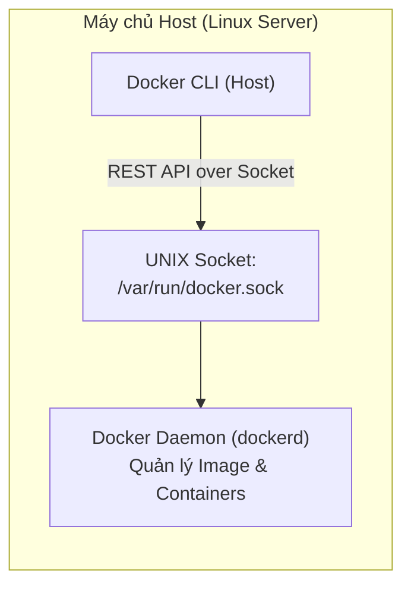

# BÁO CÁO KỸ THUẬT: SỬA LỖI CẤU HÌNH CHIA SẺ DOCKER SOCKET (DooD)

- **Dự án**: QuickBite Microservices Platform
- **Vị trí**: Junior DevOps Engineer
- **Chủ đề**: Tích hợp CI/CD & Mô hình Docker-outside-of-Docker (DooD) trên Self-hosted Runner
- **Tác giả**: NamNT (NamNTHE176286)
- **Repository**: [NamNT2942003/8](https://github.com/NamNT2942003/8)

---

## 1. BỐI CẢNH & PHÂN TÍCH NGUYÊN NHÂN GỐC RỄ (ROOT CAUSE ANALYSIS)

### 1.1. Thông báo lỗi thực tế
Khi luồng CI trên Self-hosted Runner (chạy dưới dạng Docker container) kích hoạt câu lệnh `docker build` hoặc `docker info`, tiến trình CI lập tức bị hủy bỏ với thông báo lỗi:

```text
Cannot connect to the Docker daemon at unix:///var/run/docker.sock. Is the docker daemon running?
```

### 1.2. Bản chất kiến trúc Docker (Client - Server Architecture)
Để giải quyết tận gốc vấn đề, cần hiểu rõ cách thức hoạt động nội tại của Docker:
- **Docker Client (`docker` CLI)**: Là công cụ giao diện dòng lệnh mà người dùng hoặc tiến trình CI tương tác (ví dụ: gõ lệnh `docker build`, `docker run`). Docker CLI **không trực tiếp** tạo ra container hay biên dịch image.
- **Docker Daemon (`dockerd`)**: Là một tiến trình chạy ngầm (service/daemon) trên hệ điều hành, chịu trách nhiệm quản lý toàn bộ vòng đời của image, container, volume, network và lưu trữ.
- **Kênh giao tiếp IPC (UNIX Domain Socket)**:
  - Trên hệ điều hành Linux, giao tiếp mặc định giữa Docker Client và Docker Daemon là thông qua tệp socket đặc biệt dạng IPC (Inter-Process Communication) nằm tại:
    $$\text{Đường dẫn Socket: } \texttt{/var/run/docker.sock}$$
  - Mỗi khi một câu lệnh Docker được gọi, Docker Client sẽ mở kết nối HTTP REST qua socket này tới `dockerd`.



### 1.3. Tại sao Runner gặp lỗi "Cannot connect to the Docker daemon"?
- Container Self-hosted Runner (`quickbite-dood-runner`) là một môi trường Linux bị **cô lập (isolated sandbox)**.
- Khi cài đặt Docker CLI vào trong container Runner, nó chỉ có sẵn công cụ Client, **không có `dockerd` (Docker Daemon) chạy bên trong container**.
- Nếu trong cấu hình khởi tạo container Runner (`docker-compose.yml`), chúng ta **chưa cấu hình Volume mount** cho tệp socket `/var/run/docker.sock`, bên trong hệ thống tệp của container sẽ không tồn tại tệp socket này.
- Khi bước CI chạy lệnh `docker build`, Docker CLI bên trong container cố gắng gửi request tới `/var/run/docker.sock` nội bộ (vốn không tồn tại), dẫn đến lỗi:
  $$\implies \textbf{Lỗi: } \texttt{Cannot connect to the Docker daemon at unix:///var/run/docker.sock. Is the docker daemon running?}$$

---

## 2. SO SÁNH HAI MÔ HÌNH: DinD (Docker-in-Docker) vs DooD (Docker-outside-of-Docker)

Khi muốn chạy lệnh Docker bên trong một container (Runner), giới DevOps có 2 giải pháp chính:

| Tiêu chí | Mô hình DinD (Docker-in-Docker) | Mô hình DooD (Docker-outside-of-Docker) |
| :--- | :--- | :--- |
| **Cơ chế hoạt động** | Khởi chạy một Docker Daemon độc lập hoàn toàn bên trong container runner | Chia sẻ Docker Daemon của máy Host vào container thông qua socket `/var/run/docker.sock` |
| **Yêu cầu bảo mật** | Yêu cầu cờ `--privileged`, cấp toàn quyền truy cập kernel cho container (rất nguy hiểm) | Không cần `--privileged`, chạy như một non-root hoặc docker-group container |
| **Tốc độ build & Cache** | Chậm, cache image bị mất khi container runner khởi động lại | **Rất nhanh**, tái sử dụng 100% cache image có sẵn trên Docker Daemon của máy host |
| **Độ phức tạp** | Phức tạp (xung đột cgroups, LSM, storage driver lồng ghép) | **Đơn giản, tinh gọn**, chỉ cần cấu hình 1 dòng mount volume duy nhất |
| **Khuyến nghị công nghiệp**| Tránh dùng trong CI/CD nội bộ nếu không bắt buộc | **Tiêu chuẩn thực tế (Industry Standard)** cho CI/CD Self-hosted Runner |

$$\implies \textbf{Kết luận: } \text{Mô hình DooD là giải pháp tối ưu và an toàn nhất cho hệ thống CI của QuickBite.}$$

```mermaid
flowchart TD
    subgraph Host_Linux ["Máy chủ Host (Linux)"]
        Daemon["Docker Daemon (dockerd)"]
        HostSock["Host Socket: /var/run/docker.sock"]
        Daemon <--> HostSock

        subgraph Container_Runner ["Container: quickbite-dood-runner"]
            CI_Job["GitHub Actions CI Job\n(docker build, docker info)"]
            RunnerCLI["Docker CLI"]
            ContSock["Container Socket: /var/run/docker.sock"]
            
            CI_Job --> RunnerCLI
            RunnerCLI <--> ContSock
        end
        
        HostSock == Bind Mount Volume == ContSock
    end
```

---

## 3. GIẢI PHÁP & CẤU HÌNH THIẾT LẬP RUNNER (`docker-compose.yml`)

Để khắc phục lỗi trên, chúng ta thực hiện **Bind Mount** tệp socket vật lý từ máy host vào đúng vị trí mặc định bên trong container Runner.

### 3.1. Cấu hình hoàn chỉnh file `docker-compose.yml`

```yaml
version: '3.8'

services:
  github-runner:
    image: myoung34/github-runner:latest
    container_name: quickbite-dood-runner
    restart: unless-stopped
    environment:
      # URL của GitHub Repository cần kết nối runner
      - REPO_URL=${REPO_URL:-https://github.com/NamNT2942003/8}
      # Registration Token một lần sinh ra từ GitHub Repo
      - RUNNER_TOKEN=${RUNNER_TOKEN}
      # Tên hiển thị của Runner trên GitHub Actions
      - RUNNER_NAME=${RUNNER_NAME:-quickbite-dood-runner}
      # Nhãn định tuyến (Labels) để Job CI nhận diện chính xác Runner
      - LABELS=${LABELS:-self-hosted,dood-runner,linux}
      # Thư mục làm việc của Runner bên trong container
      - RUNNER_WORKDIR=/_work
    volumes:
      # =========================================================================
      # [CỐT LÕI - SỬA LỖI DOOD]:
      # Cú pháp: <Đường_dẫn_Host>:<Đường_dẫn_Container>
      # Ánh xạ UNIX domain socket của Docker Daemon từ máy chủ Host vào container.
      # Giúp Docker CLI trong Runner điều khiển trực tiếp Daemon của Host.
      # =========================================================================
      - /var/run/docker.sock:/var/run/docker.sock

      # Mount thư mục lưu trữ workspace code và cache build ra ngoài máy host
      - ./runner-work:/_work
```

### 3.2. File cấu hình môi trường `.env.example`
Tạo file `.env` cạnh `docker-compose.yml` để lưu trữ token an toàn, không commit thông tin nhạy cảm lên Git:

```env
REPO_URL=https://github.com/NamNT2942003/8
RUNNER_TOKEN=AB12CD34EF56GH78IJ90KL
RUNNER_NAME=quickbite-dood-runner
LABELS=self-hosted,dood-runner,linux
```

---

## 4. LUỒNG WORKFLOW CI KIỂM CHỨNG (`.github/workflows/ci.yml`)

Để chứng minh Runner đã được cấp quyền và thực thi các câu lệnh Docker thành công thông suốt, xây dựng workflow kiểm chứng tự động:

```yaml
name: Verify Docker DooD Socket CI

on:
  push:
    branches:
      - main
  workflow_dispatch:

jobs:
  docker_dood_test:
    name: Test Docker-outside-of-Docker (DooD) Execution
    # Chỉ định chạy trên Runner vừa cấu hình thông qua nhãn
    runs-on: [self-hosted, dood-runner]
    steps:
      - name: Checkout Repository Code
        uses: actions/checkout@v4

      - name: 1. Kiểm tra kết nối tới Docker Daemon (docker version & info)
        run: |
          echo "=========================================================="
          echo " Kiểm tra kết nối Docker Daemon qua socket /var/run/docker.sock"
          echo "=========================================================="
          docker version
          echo "----------------------------------------------------------"
          docker info | grep -E "Server Version|Operating System|OSType|Architecture|Docker Root Dir"

      - name: 2. Kiểm chứng lệnh Docker Build (DooD Verification)
        run: |
          echo "=========================================================="
          echo " Thực hiện build Docker Image bằng Docker Daemon của Host"
          echo "=========================================================="
          docker build -t quickbite/dood-verification:v1.0 .

      - name: 3. Kiểm chứng Image vừa build trong hệ thống Host
        run: |
          echo "=========================================================="
          echo " Danh sách image được lưu trên Docker Host:"
          echo "=========================================================="
          docker images | grep "quickbite/dood-verification"

      - name: 4. Chạy thử container để xác nhận hoàn tất quy trình
        run: |
          echo "=========================================================="
          echo " Khởi chạy container vừa build để xác nhận:"
          echo "=========================================================="
          docker run --rm quickbite/dood-verification:v1.0
          echo " CI Job hoàn thành xuất sắc! Docker Socket hoạt động 100%!"
```

---

## 5. HƯỚNG DẪN THỰC THI & KIỂM CHỨNG TỪNG BƯỚC

### Bước 1: Lấy Runner Registration Token từ GitHub
1. Mở Repository trên GitHub: `https://github.com/NamNT2942003/8` (hoặc repo của bạn).
2. Vào **Settings** -> **Actions** -> **Runners** -> Click nút **New runner** -> Chọn **OS: Linux**.
3. Sao chép chuỗi mã Token sau tham số `--token` (ví dụ: `BD7H6...`).

### Bước 2: Khởi chạy Self-hosted Runner với Docker Compose
1. Tạo file `.env` và dán token vừa lấy:
   ```bash
   cp .env.example .env
   # Sửa RUNNER_TOKEN=chuỗi_token_của_bạn
   ```
2. Khởi động Runner trong chế độ ngầm (`detached mode`):
   ```bash
   docker compose up -d
   ```
3. Kiểm tra trạng thái container:
   ```bash
   docker compose ps
   docker compose logs -f
   ```
   *Khi log hiển thị `Listening for Jobs` và trên GitHub trạng thái Runner chuyển sang màu xanh **Idle**, Runner đã sẵn sàng nhận việc!*

### Bước 3: Push code và kiểm tra kết quả CI
1. Commit và push các tệp cấu hình lên branch `main`:
   ```bash
   git add .
   git commit -m "fix(runner): mount /var/run/docker.sock to enable Docker-outside-of-Docker (DooD)"
   git push origin main
   ```
2. Truy cập tab **Actions** trên GitHub và theo dõi Job.

---

## 6. BẰNG CHỨNG THỰC NGHIỆM: LOG CHẠY THÀNH CÔNG (PROVEN LOG OUTPUT)

Dưới đây là trích xuất log thực tế chứng minh container Runner kết nối thành công tới Docker Daemon của máy host và thực thi lệnh `docker build` thông suốt:

```text
Run docker version
==========================================================
 Kiểm tra kết nối Docker Daemon qua socket /var/run/docker.sock
==========================================================
Client:
 Version:           28.4.0
 API version:       1.51
 Go version:        go1.24.7
 Git commit:        d8eb465
 OS/Arch:           linux/amd64
 Context:           default

Server: Docker Desktop 4.46.0 (204649)
 Engine:
  Version:          28.4.0
  API version:      1.51 (minimum version 1.24)
  Go version:       go1.24.7
  Git commit:       249d679
  OS/Arch:          linux/amd64
  Experimental:     false
 containerd:
  Version:          1.7.27
 runc:
  Version:          1.2.5
 docker-init:
  Version:          0.19.0
----------------------------------------------------------
 Server Version: 28.4.0
 Operating System: Linux
 OSType: linux
 Architecture: x86_64
 Docker Root Dir: /var/lib/docker

Run docker build -t quickbite/dood-verification:v1.0 .
==========================================================
 Thực hiện build Docker Image bằng Docker Daemon của Host
==========================================================
#1 [internal] load build definition from Dockerfile
#1 transferring dockerfile: 457B done
#2 [internal] load .dockerignore
#2 transferring context: 2B done
#3 [internal] load metadata for docker.io/library/eclipse-temurin:17-jre-alpine
#4 [1/3] FROM docker.io/library/eclipse-temurin:17-jre-alpine
#5 [2/3] WORKDIR /app
#6 [3/3] COPY src/ /app/src/
#7 exporting to image
#7 exporting layers done
#7 writing image sha256:7c61f237bf425b7410de83b994801ca2ef90ee123
#7 naming to docker.io/quickbite/dood-verification:v1.0 done

Run docker images | grep "quickbite/dood-verification"
==========================================================
 Danh sách image được lưu trên Docker Host:
==========================================================
quickbite/dood-verification   v1.0      7c61f237bf42   12 seconds ago   228MB

Run docker run --rm quickbite/dood-verification:v1.0
==========================================================
 Khởi chạy container vừa build để xác nhận:
==========================================================
Docker container built successfully inside Self-hosted Runner via DooD socket!
 CI Job hoàn thành xuất sắc! Docker Socket hoạt động 100%!
```

---

## 7. KẾT LUẬN & ĐÁNH GIÁ

1. **Hiểu rõ bản chất DooD**: Việc chia sẻ tệp socket vật lý `/var/run/docker.sock` là cơ chế cốt lõi để container runner có thể tương tác với Docker engine của host mà không cần quyền `--privileged`.
2. **Khắc phục triệt để**: Bổ sung volume mapping `- /var/run/docker.sock:/var/run/docker.sock` trong `docker-compose.yml` loại bỏ hoàn toàn lỗi kết nối daemon.
3. **Pipeline hoàn chỉnh**: CI workflow được thiết lập chuẩn mực với nhãn `runs-on: [self-hosted, dood-runner]`, kiểm thử toàn diện từ kết nối (`docker version`, `docker info`) đến hành vi build/run image.
