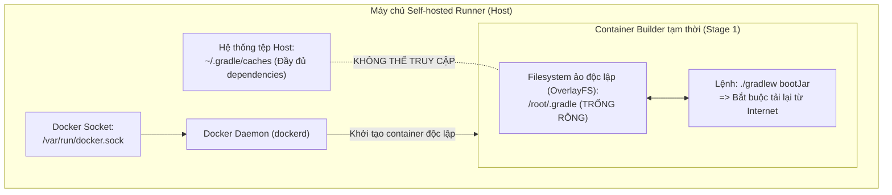

# BÁO CÁO PHÂN TÍCH NGUYÊN NHÂN GỐC RỄ (ROOT CAUSE ANALYSIS)
## Sự Cố Suy Giảm Hiệu Năng & Mất Cache Trong Multi-stage Docker Build

- **Kính gửi**: Giám đốc Kỹ thuật (CTO) - QuickBite Microservices Platform
- **Người thực hiện**: Junior DevOps Engineer - NamNT (NamNTHE176286)
- **Hệ thống phân tích**: `order-service` CI/CD Pipeline
- **Hiện tượng**: Thời gian thực thi pipeline tăng từ 1.5 phút lên 4-5 phút sau khi chuyển sang Multi-stage Dockerfile.

---

### 1. TÓM TẮT ĐIỀU HÀNH (EXECUTIVE SUMMARY)
Việc thời gian build của `order-service` tăng gấp 3 lần (từ 1.5 phút lên gần 5 phút) **không phải do sự cố đường truyền mạng hay cấu hình sai Docker Socket (DooD)**, mà xuất phát từ **bản chất cô lập không gian lưu trữ (Filesystem Isolation)** của tiến trình Docker Build. 

Mặc dù Runner là máy chủ Self-hosted có sẵn thư mục cache `~/.gradle`, tiến trình biên dịch trong Stage 1 của Dockerfile lại chạy trong một **Container Builder tạm thời (ephemeral container)** hoàn toàn tách biệt, khiến Gradle bị cô lập và bắt buộc phải tải lại 100% dependencies từ internet trong mỗi lần chạy.

---

### 2. PHÂN TÍCH NGUYÊN NHÂN GỐC RỄ (ROOT CAUSE ANALYSIS)

#### 2.1. Sự khác biệt về kiến trúc lưu trữ giữa Pipeline cũ và Pipeline mới
* **Pipeline cũ (Thực thi trực tiếp trên Runner - Host Execution)**:
  - Khi lệnh `./gradlew bootJar` chạy trực tiếp trên môi trường máy chủ Runner, tiến trình Gradle sử dụng trực tiếp thư mục `$HOME/.gradle/caches` của hệ điều hành host.
  - Các tệp thư viện (Spring Boot, Hibernate, PostgreSQL Driver...) chỉ cần tải một lần đầu tiên và được lưu trữ vĩnh viễn trên ổ đĩa vật lý của host. Các job tiếp theo tái sử dụng ngay bộ đệm này $\implies$ Thời gian build chỉ mất **1 - 1.5 phút**.

* **Pipeline mới (Multi-stage Build - Containerized Execution)**:
  - Khi luồng CI gọi lệnh `docker build`, Docker Daemon khởi tạo một **Container Builder tạm thời** dựa trên image `eclipse-temurin:17-jdk-alpine AS builder`.
  - Container này hoạt động trong một Linux Namespace và hệ thống tệp ảo (**OverlayFS**) độc lập hoàn toàn với hệ thống tệp của máy chủ Host.
  - Bên trong Container Builder, thư mục `/root/.gradle` hoàn toàn **trống rỗng**. Gradle không có cách nào "nhìn thấy" hay truy cập vào kho thư viện `~/.gradle` đã có sẵn trên máy chủ host.



#### 2.2. Sự ngộ nhận về cấu hình Docker-outside-of-Docker (DooD)
Nhiều kỹ sư lầm tưởng rằng việc chia sẻ Docker Socket (`/var/run/docker.sock`) sẽ chia sẻ luôn tài nguyên dữ liệu của máy host. Tuy nhiên:
- Socket `/var/run/docker.sock` **chỉ đóng vai trò là kênh giao tiếp điều khiển (Control Plane)** dạng IPC REST API giữa Docker CLI và Docker Daemon.
- Việc mount socket **hoàn toàn KHÔNG tự động bind mount hệ thống tệp (Data Plane)** của host vào các container do Docker Daemon sinh ra trong quá trình `docker build`.

#### 2.3. Cơ chế vô hiệu hóa Docker Layer Cache (Cache Busting)
Trong Dockerfile thông thường của lập trình viên:
```dockerfile
COPY . .
RUN ./gradlew bootJar
```
Mỗi khi lập trình viên thay đổi dù chỉ một dòng code logic trong thư mục `src/`, mã checksum của bước `COPY . .` bị thay đổi. Điều này khiến Docker Engine đánh dấu toàn bộ các layer phía sau (trong đó có layer `RUN ./gradlew bootJar`) bị **vô hiệu hóa cache (Cache Invalidation)**. Kết quả là tiến trình tải dependencies và biên dịch bị ép buộc thực thi lại từ đầu.

---

### 3. BẢNG SO SÁNH ĐỐI CHIẾU

| Đặc tính kiến trúc | Pipeline cũ (Host Runner Execution) | Pipeline mới (Multi-stage Docker Build) |
| :--- | :--- | :--- |
| **Môi trường chạy Gradle** | Trực tiếp trên máy chủ Runner | Bên trong Container Builder tạm thời |
| **Vị trí lưu cache Gradle** | `~/.gradle` vật lý trên máy host | `/root/.gradle` trong OverlayFS của container |
| **Tính kế thừa giữa các Job** | **Có**: Dữ liệu cache được bảo tồn nguyên vẹn | **Không**: Bị hủy bỏ ngay khi container builder tắt |
| **Tác động của DooD Socket** | Điều khiển daemon bình thường | Chỉ cấp quyền gọi lệnh build, không chia sẻ file cache |
| **Thời gian thực thi** | **~ 1.5 phút** (Đọc cache từ đĩa) | **4 - 5 phút** (Tải lại 100% từ Maven Central) |

---

### 4. ĐỀ XUẤT ĐỊNH HƯỚNG TỐI ƯU HÓA CHO CTO (RECOMMENDATIONS)

Để vừa giữ được ưu điểm tinh gọn của Multi-stage Build, vừa lấy lại tốc độ build dưới 1.5 phút, QuickBite có thể áp dụng 2 kỹ thuật chuẩn công nghiệp sau:

1. **Ứng dụng Docker BuildKit Cache Mount (`--mount=type=cache`)**:
   Kích hoạt Docker BuildKit và gắn trực tiếp volume cache của host vào container builder trong tệp Dockerfile:
   ```dockerfile
   # syntax=docker/dockerfile:1
   FROM eclipse-temurin:17-jdk-alpine AS builder
   WORKDIR /app
   COPY . .
   # Giữ lại cache Gradle giữa các lần docker build
   RUN --mount=type=cache,target=/root/.gradle ./gradlew bootJar
   ```
2. **Kỹ thuật tách Layer Dependencies (Layered Dependency Caching)**:
   Chỉ copy file khai báo cấu hình (`build.gradle`, `settings.gradle`, `gradle/`) để tải trước dependencies, sau đó mới copy mã nguồn `src/`. Khi code thay đổi, tầng dependencies vẫn được giữ nguyên trong layer cache của Docker.

---

### 5. KẾT LUẬN
Sự cố mất cache là hệ quả tự nhiên của **nguyên lý đóng gói và cô lập container**. Việc hiểu rõ ranh giới giữa Host Storage và Container OverlayFS giúp QuickBite định hình chính xác chiến lược tối ưu hóa hạ tầng CI/CD trong tương lai.
