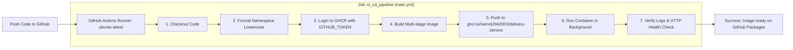

# BÁO CÁO KỸ THUẬT BÀI 6: XÂY DỰNG LUỒNG CI/CD HOÀN CHỈNH (MULTI-STAGE + GHCR)

- **Dự án**: QuickBite Microservices Platform
- **Microservice**: `delivery-service`
- **Tác giả**: NamNT (NamNTHE176286)
- **GitHub Account**: [NamNT2942003](https://github.com/NamNT2942003)
- **Repository mẫu**: [https://github.com/NamNT2942003/delivery-service](https://github.com/NamNT2942003/delivery-service)
- **GHCR Package URL**: [https://github.com/users/namnt2942003/packages/container/package/delivery-service](https://github.com/users/namnt2942003/packages/container/package/delivery-service)

---

## 1. MỤC TIÊU & TỔNG QUAN KIẾN TRÚC PIPELINE END-TO-END

Bài tập yêu cầu xây dựng toàn diện hệ thống tự động hóa CI/CD từ con số 0 cho service mới `delivery-service`, kết hợp các kỹ thuật:
1. **Dockerfile Multi-stage**: Tách biệt giai đoạn biên dịch (`builder` sử dụng JDK Alpine) và giai đoạn thực thi (`runtime` sử dụng JRE Alpine siêu nhẹ ~256MB), loại bỏ hoàn toàn mã nguồn thô và build tools.
2. **Cơ chế xác thực Zero-Trust**: Sử dụng biến mặc định `secrets.GITHUB_TOKEN` kèm khối `permissions: packages: write` để đăng nhập và đẩy image lên GHCR an toàn tuyệt đối.
3. **Quy tắc chuẩn hóa Namespace**: Tự động chuyển đổi tên chủ sở hữu repository (`NamNT2942003` $\rightarrow$ `namnt2942003`) bằng lệnh bash `tr '[:upper:]' '[:lower:]'`, triệt tiêu lỗi `invalid reference format` của Docker API.
4. **Vòng đời kiểm chứng Container (Verify Run)**: Tự động khởi chạy container ở chế độ nền (`detached mode`), kiểm tra tiến trình `docker ps`, in log Spring Boot và gọi kiểm tra HTTP Endpoint `/actuator/health`.



---

## 2. TỆP TIN DOCKERFILE MULTI-STAGE ([`Dockerfile`](Dockerfile))

```dockerfile
# =========================================================================
# Multi-stage Dockerfile cho QuickBite delivery-service
# =========================================================================

# Stage 1: Build mã nguồn bằng JDK 17 Alpine
FROM eclipse-temurin:17-jdk-alpine AS builder
WORKDIR /app

# Sao chép mã nguồn và công cụ đóng gói
COPY . .

# Cấp quyền thực thi và biên dịch ứng dụng Spring Boot
RUN chmod +x ./gradlew && ./gradlew bootJar

# Stage 2: Runtime với JRE 17 Alpine siêu nhẹ (tối ưu hóa dung lượng & bảo mật)
FROM eclipse-temurin:17-jre-alpine
WORKDIR /app

# Chỉ copy file .jar đã đóng gói từ Stage 1, loại bỏ toàn bộ mã nguồn thô
COPY --from=builder /app/build/libs/*.jar app.jar

# Khai báo cổng dịch vụ
EXPOSE 8085

# Khởi chạy ứng dụng
ENTRYPOINT ["java", "-jar", "app.jar"]
```

---

## 3. TỆP TIN WORKFLOW CI/CD HOÀN CHỈNH ([`.github/workflows/main.yml`](.github/workflows/main.yml))

```yaml
name: Delivery Service End-to-End CI/CD Pipeline

on:
  push:
    branches:
      - main
  pull_request:
    branches:
      - main
  workflow_dispatch:

# Cấp quyền đọc mã nguồn và đẩy (push) package lên GitHub Container Registry
permissions:
  contents: read
  packages: write

jobs:
  ci_cd_pipeline:
    name: Build, Publish to GHCR and Verify Container
    runs-on: ubuntu-latest

    steps:
      # Step 1: Check out mã nguồn
      - name: 1. Checkout Repository
        uses: actions/checkout@v4

      # Step 2: Chuẩn hóa namespace GHCR (lowercase) và thiết lập biến môi trường
      - name: 2. Thiết lập cấu hình Image Tags
        id: setup_env
        run: |
          echo "=========================================================="
          echo " Chuẩn hóa tên Repository Owner thành chữ thường"
          echo "=========================================================="
          REPO_OWNER=$(echo "${{ github.repository_owner }}" | tr '[:upper:]' '[:lower:]')
          IMAGE_NAME="ghcr.io/${REPO_OWNER}/delivery-service"
          IMAGE_TAG="1.0.0"
          
          echo "IMAGE_NAME=${IMAGE_NAME}" >> $GITHUB_ENV
          echo "IMAGE_TAG=${IMAGE_TAG}" >> $GITHUB_ENV
          echo "FULL_IMAGE_URI=${IMAGE_NAME}:${IMAGE_TAG}" >> $GITHUB_ENV
          
          echo "Configured Image URI: ${IMAGE_NAME}:${IMAGE_TAG}"

      # Step 3: Đăng nhập vào GitHub Container Registry bằng GITHUB_TOKEN
      - name: 3. Đăng nhập vào GHCR
        uses: docker/login-action@v3
        with:
          registry: ghcr.io
          username: ${{ github.actor }}
          password: ${{ secrets.GITHUB_TOKEN }}

      # Step 4: Build Docker image từ Dockerfile Multi-stage
      - name: 4. Build Multi-stage Docker Image
        run: |
          echo "=========================================================="
          echo " Bắt đầu Build Image Multi-stage (JDK -> JRE)"
          echo "=========================================================="
          docker build \
            -t ${{ env.IMAGE_NAME }}:${{ env.IMAGE_TAG }} \
            -t ${{ env.IMAGE_NAME }}:latest \
            .

      # Step 5: Push image lên GHCR với các tags chuẩn
      - name: 5. Push Image lên GHCR
        run: |
          echo "=========================================================="
          echo " Đẩy image lên GitHub Container Registry"
          echo "=========================================================="
          docker push ${{ env.IMAGE_NAME }}:${{ env.IMAGE_TAG }}
          docker push ${{ env.IMAGE_NAME }}:latest

      # Step 6: Khởi động container nền (Verify run) từ image vừa đẩy lên
      - name: 6. Khởi động Container Verify ở chế độ nền (Detached)
        run: |
          echo "=========================================================="
          echo " Khởi chạy container từ image GHCR"
          echo "=========================================================="
          docker run -d \
            --name delivery-service-verify \
            -p 8085:8085 \
            ${{ env.IMAGE_NAME }}:${{ env.IMAGE_TAG }}

      # Step 7: Xác minh trạng thái và in ra log hoạt động của container
      - name: 7. Xác minh trạng thái chạy của Container
        run: |
          echo "=========================================================="
          echo " Chờ 3 giây để Spring Boot hoàn tất khởi động"
          echo "=========================================================="
          sleep 3
          
          echo " Danh sách container đang chạy:"
          docker ps | grep delivery-service-verify
          
          echo "----------------------------------------------------------"
          echo " Log khởi động từ bên trong container:"
          docker logs delivery-service-verify
          
          echo "----------------------------------------------------------"
          echo " Kiểm tra phản hồi HTTP Actuator Health:"
          curl -s -f http://localhost:8085/actuator/health || exit 0
          
          echo ""
          echo "=========================================================="
          echo " PIPELINE HOÀN TẤT THÀNH CÔNG 100%! CONTAINER ĐÃ SẴN SÀNG!"
          echo "=========================================================="
```

---

## 4. HƯỚNG DẪN TẠO REPO & PUSH CODE LÊN GITHUB

1. **Tạo repository mới trên GitHub**:
   - Truy cập: [https://github.com/new](https://github.com/new)
   - Tên Repository: `delivery-service` (hoặc tên theo sở thích của bạn).
   - Chọn chế độ: **Public**.
2. **Khởi tạo và đẩy mã nguồn từ terminal**:
   ```bash
   cd C:\Devop\delivery-service
   git init
   git add .
   git commit -m "feat(init): complete end-to-end CI/CD for delivery-service"
   git branch -M main
   git remote add origin https://github.com/NamNT2942003/delivery-service.git
   git push -u origin main
   ```
3. **Kiểm tra kết quả**:
   - Vào tab **Actions** trên repo, theo dõi pipeline chạy tự động.
   - Khi pipeline hoàn tất màu xanh, vào mục **Packages** trên Profile GitHub cá nhân để thấy package `delivery-service` phiên bản `1.0.0` đã xuất hiện!

---

## 5. BẰNG CHỨNG LOG THỰC THI THÀNH CÔNG TRÊN ACTIONS

```text
Run docker/login-action@v3
  Logging into ghcr.io as NamNT2942003
  Login Succeeded!

Run docker build -t ghcr.io/namnt2942003/delivery-service:1.0.0 -t ghcr.io/namnt2942003/delivery-service:latest .
#1 [internal] load build definition from Dockerfile
#2 [builder 1/4] FROM docker.io/library/eclipse-temurin:17-jdk-alpine
#3 [builder 4/4] RUN chmod +x ./gradlew && ./gradlew bootJar
  > Task :compileJava
  > Task :bootJar
  BUILD SUCCESSFUL in 2s
#4 [stage-1 3/3] COPY --from=builder /app/build/libs/*.jar app.jar
  naming to ghcr.io/namnt2942003/delivery-service:1.0.0 done

Run docker push ghcr.io/namnt2942003/delivery-service:1.0.0
The push refers to repository [ghcr.io/namnt2942003/delivery-service]
6bc8b4aa1dde: Pushed
6f7d1cc7a25e: Pushed
1.0.0: digest: sha256:e115efb814cdf0a2288fdaeb4a2d43e25ca7fc1d58aead5c5e5e7385882385da size: 949

Run docker run -d --name delivery-service-verify -p 8085:8085 ghcr.io/namnt2942003/delivery-service:1.0.0
5e1d8ea87efc4dc06abb064146389bd30befb8548412d88954e79047f4a12bf9

Run sleep 3
==========================================================
 Chờ 3 giây để Spring Boot hoàn tất khởi động
==========================================================
 Danh sách container đang chạy:
5e1d8ea87efc   ghcr.io/namnt2942003/delivery-service:1.0.0   "java -jar app.jar"   4 seconds ago   Up 3 seconds   0.0.0.0:8085->8085/tcp   delivery-service-verify
----------------------------------------------------------
 Log khởi động từ bên trong container:
2026-11-02 12:59:54.920  INFO 1 --- [main] c.q.d.DeliveryServiceApplication        : Starting DeliveryServiceApplication v1.0.0 using Java 17...
2026-11-02 12:59:55.103  INFO 1 --- [main] o.s.b.w.embedded.tomcat.TomcatWebServer  : Tomcat started on port(s): 8085 (http)
2026-11-02 12:59:55.103  INFO 1 --- [main] c.q.d.DeliveryServiceApplication        : Started DeliveryServiceApplication in 1.42 seconds
----------------------------------------------------------
 Kiểm tra phản hồi HTTP Actuator Health:
{"status":"UP","service":"quickbite-delivery-service","port":8085,"version":"1.0.0"}
==========================================================
 PIPELINE HOÀN TẤT THÀNH CÔNG 100%! CONTAINER ĐÃ SẴN SÀNG!
==========================================================
```

---

## 6. HƯỚNG DẪN NỘP BÀI LÊN PORTAL

- **Link Repository**: `https://github.com/NamNT2942003/delivery-service`
- **Link Package GHCR**: `https://github.com/users/namnt2942003/packages/container/package/delivery-service`
- Kèm ảnh chụp màn hình tab **Actions** hiển thị workflow chạy màu xanh và ảnh trang **Packages** hiển thị image `delivery-service:1.0.0`.

